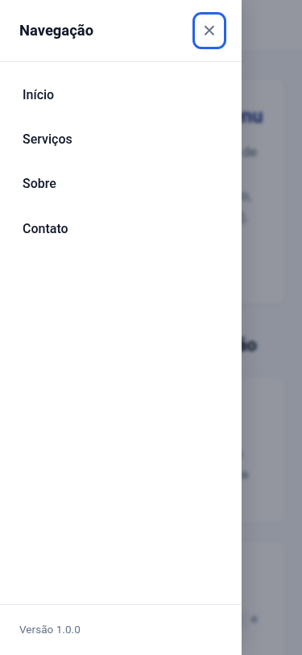

# Sliding Menu Component

Componente reutilizável e acessível de **Menu Lateral Deslizante (Sliding Menu / Drawer)** desenvolvido em HTML5 semântico, CSS3 e JavaScript puro (Vanilla JS).

Projeto desenvolvido para a **Atividade #1 (Capstone)**.

---

## 📌 Propósito

O objetivo deste projeto é disponibilizar um componente de navegação lateral deslizante leve, robusto e acessível, pronto para ser incorporado a páginas web ou fazer parte de uma biblioteca compartilhada de componentes de interface.

---

## 🚀 Tecnologias Utilizadas

- **HTML5 Semântico:** Uso de tags `<header>`, `<nav>`, `<button>`, `<main>` e atributos ARIA (`aria-expanded`, `aria-controls`, `aria-hidden`).
- **CSS3 Moderno:** Transições fluidas com aceleração de hardware via `transform: translateX()`, variáveis CSS (CSS Custom Properties), overlay com desfoque e foco visual acessível (`:focus-visible`).
- **JavaScript Puro (Vanilla JS - ES6+):** Orientação a objetos com classe `SlidingMenu`, manipulação direta de DOM sem frameworks externos, controle de foco e tratamento de eventos de teclado.

---

## 📁 Estrutura de Arquivos

```
sliding-menu-component/
├── index.html                  # Página de demonstração e estrutura semântica
├── css/
│   └── style.css               # Estilos, variáveis e animações de transição
├── js/
│   └── menu.js                 # Lógica de controle, acessibilidade e eventos
├── docs/
│   ├── componente.md           # Documentação técnica aprofundada
│   ├── PDF1_Descricao_Componente.md  # Conteúdo para geração do PDF 1
│   └── PDF2_Evidencias_Funcionamento.md # Conteúdo para geração do PDF 2
├── screenshots/
│   ├── menu-fechado.png        # Evidência do menu fechado em desktop
│   ├── menu-aberto.png         # Evidência do menu aberto em desktop
│   └── menu-responsivo.png     # Evidência do menu em viewport mobile
└── README.md                   # Apresentação e guia do projeto
```

---

## ⚙️ Instruções de Execução

O componente não requer nenhum processo de compilação ou instalação de dependências.

### Opção 1: Abrir diretamente no navegador
Basta abrir o arquivo `index.html` em qualquer navegador web moderno:
```bash
# No Linux
google-chrome index.html
# Ou no macOS / Windows
open index.html # ou start index.html
```

### Opção 2: Utilizando um servidor local (Recomendado)
```bash
# Com Python 3
python3 -m http.server 8000
# Acesse no navegador: http://localhost:8000
```

ou com Node.js (`npx serve`):
```bash
npx serve .
```

---

## ✨ Funcionalidades

- **Abertura e Fechamento Suaves:** Animação de deslizamento lateral baseada em transição CSS de alta performance.
- **Fechamento Multicanal:** Fecha via botão interno (&times;), clique no overlay externo ou tecla <kbd>Escape</kbd>.
- **Acessibilidade Completa (WCAG):** Estados comunicados via `aria-expanded` e `aria-hidden`. Gestão ativa de foco para usuários de leitores de tela e teclado.
- **Responsividade Fluida:** Adapta-se a telas de smartphones, tablets e monitores desktop.
- **Bloqueio de Rolagem:** O scroll da página de fundo é desabilitado enquanto o menu estiver aberto.

---

## 📚 Métodos da API JavaScript (`SlidingMenu`)

| Método | Parâmetros | Retorno | Descrição |
| :--- | :--- | :--- | :--- |
| `openMenu()` | Nenhum | `void` | Abre o menu lateral, exibe overlay, bloqueia o scroll do body e foca o botão de fechamento. |
| `closeMenu()` | Nenhum | `void` | Fecha o menu, oculta o overlay, destrava o scroll do body e devolve o foco ao elemento chamador. |
| `toggleMenu()` | Nenhum | `void` | Alterna entre os estados aberto e fechado. |
| `handleKeydown(event)` | `event: KeyboardEvent` | `void` | Monitora a tecla `Escape` no documento e fecha o menu se estiver aberto. |

Todos os métodos contam com anotações JSDoc completas no código-fonte (`js/menu.js`).

---

## 🖼️ Capturas de Tela do Funcionamento

| Estado | Captura |
| :--- | :--- |
| **Menu Fechado** |  |
| **Menu Aberto** |  |
| **Responsivo (Mobile)** |  |

---

## 🔌 Como Integrar em Outros Projetos

1. Adicione o CSS na tag `<head>` da sua página:
   ```html
   <link rel="stylesheet" href="caminho/para/css/style.css">
   ```
2. Insira a estrutura HTML do botão, overlay e menu:
   ```html
   <button id="menu-toggle-btn" aria-expanded="false" aria-controls="sliding-menu">Menu</button>
   <div id="menu-overlay" aria-hidden="true"></div>
   <nav id="sliding-menu" class="sliding-menu" aria-hidden="true">
     <div class="menu-header">
       <h2>Menu</h2>
       <button id="menu-close-btn">&times;</button>
     </div>
     <ul class="menu-list">
       <li><a href="#link1" class="menu-link">Link 1</a></li>
     </ul>
   </nav>
   ```
3. Importe o script no final da página:
   ```html
   <script src="caminho/para/js/menu.js"></script>
   ```

---

## 🔗 Repositório GitLab

- **URL do Projeto:** `https://gitlab.com/usuario/sliding-menu-component` *(ajustar com o link do seu repositório GitLab)*
